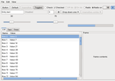
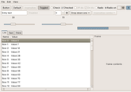
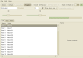
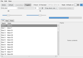
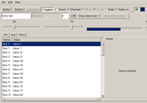
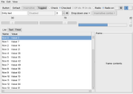
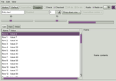

# gtk-classic-themes


GTK3 and GTK4 ports of the classic GTK2 themes and engines from the gtk-engines packages (and clearlooks 0.6.2). **Porting was done entirely by Claude, by Anthropic.** So, don't credit me, credit their Pro plan. 

> I would very much appreciate it if someone with theming experience steps in.

Colours and geometry come from the engine source and from measurements of real GTK2 renderings.

| Folder (in `themes/`) | Based on | GTK2 | GTK3 | GTK4 |
|---|---|---|---|---|
| Clearlooks | gtk-engines 2.20.2 Clearlooks (Gummy) | original gtkrc | yes | yes |
| Clearlooks-classic | clearlooks-0.6.2 Clearlooks | original gtkrc | yes | yes |
| Clearlooks-classic-deepsky | clearlooks-0.6.2 DeepSky | original gtkrc | yes | yes |
| Clearlooks-classic-olive | clearlooks-0.6.2 Olive | original gtkrc | yes | yes |
| Clearlooks-classic-quicksilver | clearlooks-0.6.2 Quicksilver | original gtkrc | yes | yes |
| Industrial | gtk-engines 2.20.2 Industrial | original gtkrc | yes | yes |
| Redmond | gtk-engines 2.20.2 Redmond | original gtkrc | yes | yes |
| Mist | gtk-engines 2.20.2 Mist | original gtkrc | yes | yes |
| ThinIce | gtk-engines 2.20.2 ThinIce | original gtkrc | yes | yes |
| Crux | gtk-engines 2.20.2 Crux | original gtkrc | yes | yes |

## Screenshots (GTK3)

Click a thumbnail for the full-size picture.

| Clearlooks | Clearlooks-classic | Clearlooks-classic-deepsky | Clearlooks-classic-olive | Clearlooks-classic-quicksilver |
|---|---|---|---|---|
| [](screenshots/Clearlooks.png) | [](screenshots/Clearlooks-classic.png) | [](screenshots/Clearlooks-classic-deepsky.png) | [](screenshots/Clearlooks-classic-olive.png) | [](screenshots/Clearlooks-classic-quicksilver.png) |

| Industrial | Redmond | Mist | ThinIce | Crux |
|---|---|---|---|---|
| [](screenshots/Industrial.png) | [](screenshots/Redmond.png) | [](screenshots/Mist.png) | [](screenshots/ThinIce.png) | [](screenshots/Crux.png) |

## Installing

- **Per user (recommended):** copy the theme folders you want from `themes/` into `~/.themes/` (for example `mkdir -p ~/.themes && cp -r themes/* ~/.themes/` for all of them) and select them in Appearance. Restart running applications afterwards.
- **System-wide:** copy them from `themes/` into `/usr/share/themes/`. In this case make sure the `gtk-2.0` folders of Clearlooks, Crux, Industrial, Redmond, Mist and ThinIce do not overwrite the ones already installed by gtk2-engines (skip or delete those `gtk-2.0` folders).

## Recommended GTK4 settings

GTK4 uses overlay (auto-hiding) scrollbars by default, which these classic themes are not designed for, and its default font rendering is not always as crisp as GTK2/GTK3. Therefore, you may need to put this in `~/.config/gtk-4.0/settings.ini`:

```
[Settings]
gtk-hint-font-metrics=true
gtk-font-rendering=manual
gtk-overlay-scrolling=false
```

- `gtk-overlay-scrolling=false` turns off overlay scrollbars, so the classic scrollbars are always visible (GTK4 has no stepper buttons). GTK3 has the same setting in `~/.config/gtk-3.0/settings.ini` if you want it there too.
- `gtk-hint-font-metrics=true` aligns text to whole pixels, which keeps small text sharp.
- `gtk-font-rendering=manual` makes GTK4 follow your own font settings (antialiasing, hinting, subpixel order from fontconfig / `gtk-xft-*`) instead of its automatic choice.

## Known limits
libadwaita apps ignore third-party themes. Firefox draws its own dialog buttons.

## Original work credits
See [AUTHORS.md](AUTHORS.md). Licences: LGPL-2.1 (see `LICENSE`); the Clearlooks-classic variants are GPL-2 (see `COPYING-GPL-2`, details in [LICENSES.md](LICENSES.md)).
