# gtk-classic-themes
[](https://claude.ai/)


GTK3 and GTK4 ports of the classic GTK2 themes from [gtk-engines](https://download.gnome.org/sources/gtk-engines/2.20/) (2.20.2) and [clearlooks](https://sourceforge.net/projects/clearlooks/files/clearlooks/clearlooks%200.6.2/) (0.6.2). Colours and geometry come from the engine source and from measurements of real GTK2 renderings. Each theme also contains a matching Xfwm4 (Xfce window manager) theme, adapted mostly from [Xfwm4 themes](https://archive.xfce.org/src/art/xfwm4-themes/4.10/) (4.10.0) and [Clearlooks-Phenix](https://github.com/jpfleury/clearlooks-phenix) (7.1).

**Porting was done entirely by Claude, by Anthropic.** So, don't credit me, credit their Pro plan. 

Joke aside, that's not the type of AI slop where I simply asked the LLM to translate and then I push online. I did (and I am still doing) extensive testing, in order to have various discrepancies fixed. I will very much appreciate any feedback, and if someone with theming experience steps in, that would be great.

## Themes
<table>
<tr>
<td align="center"><sub>Clearlooks</sub><br><a href="screenshots/Clearlooks.png">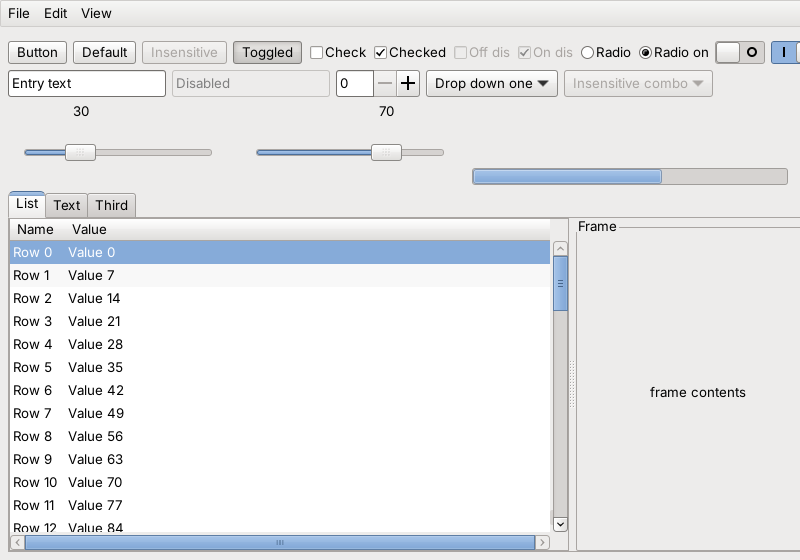</a></td>
<td align="center"><sub>Clearlooks-classic</sub><br><a href="screenshots/Clearlooks-classic.png">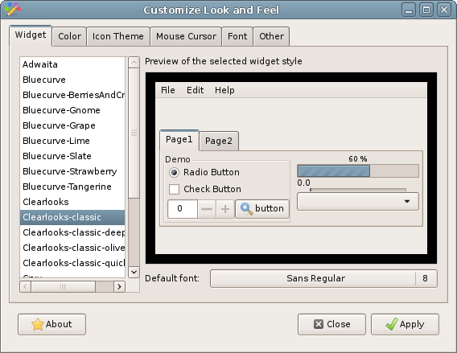</a></td>
<td align="center"><sub>Clearlooks-classic-deepsky</sub><br><a href="screenshots/Clearlooks-classic-deepsky.png">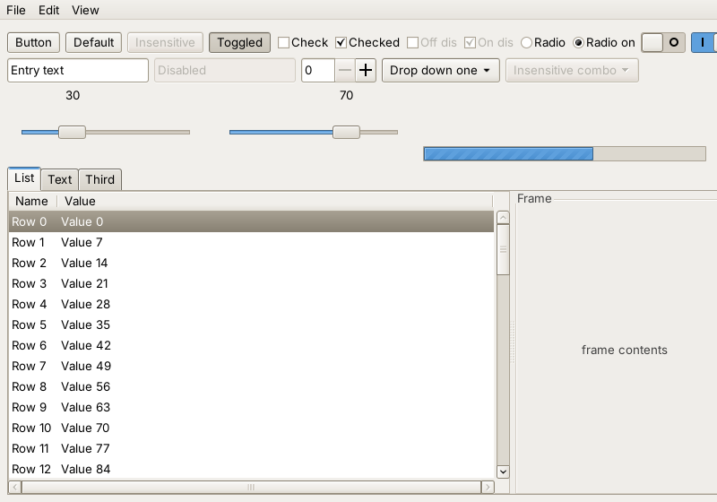</a></td>
<td align="center"><sub>Clearlooks-classic-olive</sub><br><a href="screenshots/Clearlooks-classic-olive.png">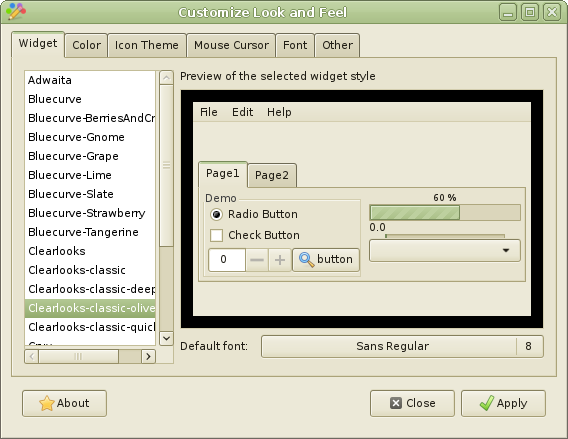</a></td>
</tr>
<tr>
<td align="center"><sub>Clearlooks-classic-quicksilver</sub><br><a href="screenshots/Clearlooks-classic-quicksilver.png"></a></td>
<td align="center"><sub>Crux</sub><br><a href="screenshots/Crux.png">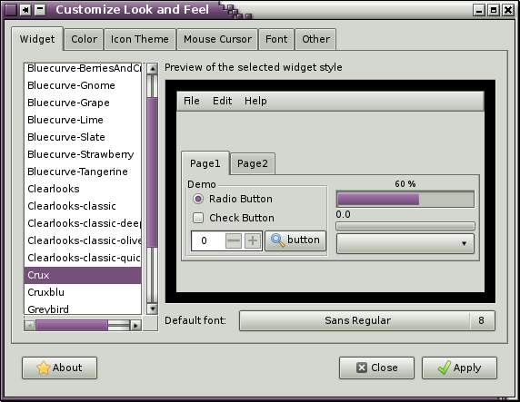</a></td>
<td align="center"><sub>Cruxblu</sub><br><a href="screenshots/Cruxblu.png">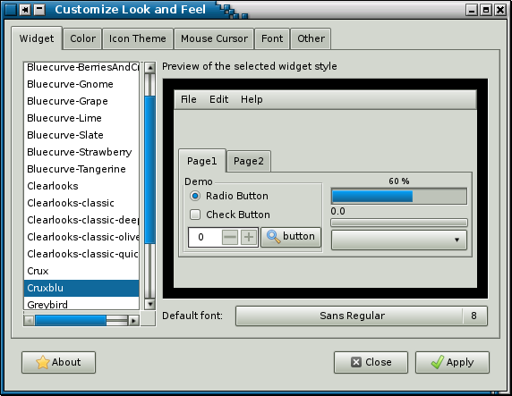</a></td>
<td align="center"><sub>Industrial</sub><br><a href="screenshots/Industrial.png">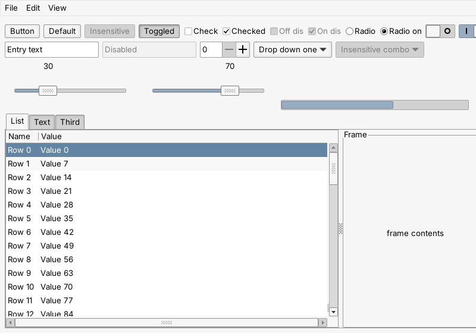</a></td>
</tr>
<tr>
<td align="center"><sub>Mist</sub><br><a href="screenshots/Mist.png">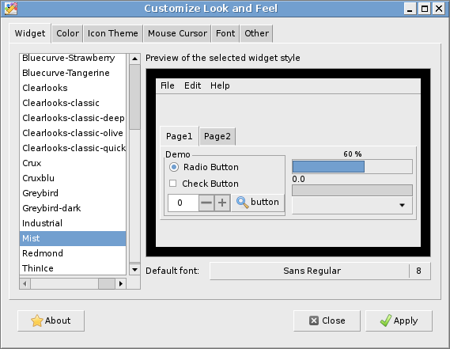</a></td>
<td align="center"><sub>Redmond</sub><br><a href="screenshots/Redmond.png">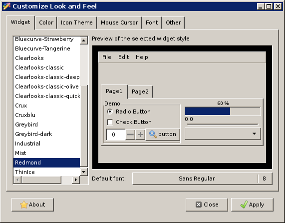</a></td>
<td align="center"><sub>Redmond-aspen</sub><br><a href="screenshots/Redmond-aspen.png">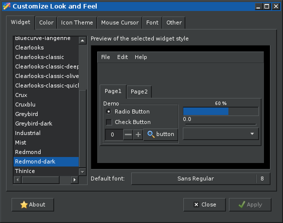</a></td>
<td align="center"><sub>ThinIce</sub><br><a href="screenshots/ThinIce.png">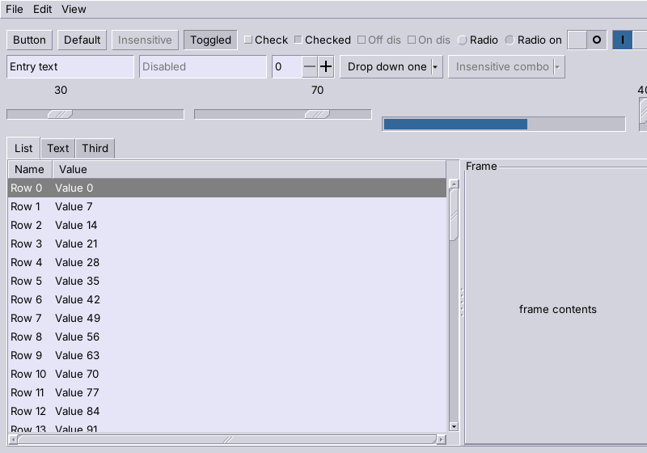</a></td>
</tr>
</table>

## Details
| Folder (in `themes/`) | Based on | GTK2 | GTK3 | GTK4 | Xfwm4 |
|---|---|---|---|---|---|
| Clearlooks | gtk-engines 2.20.2 Clearlooks | original | ported | ported | recoloured |
| Clearlooks-classic | clearlooks-0.6.2 Clearlooks | original | ported | ported | recoloured |
| Clearlooks-classic-deepsky | clearlooks-0.6.2 DeepSky | original | ported | ported | recoloured |
| Clearlooks-classic-olive | clearlooks-0.6.2 Olive | original | ported | ported | recoloured |
| Clearlooks-classic-quicksilver | clearlooks-0.6.2 Quicksilver | original | ported | ported | recoloured |
| Crux | gtk-engines 2.20.2 Crux | original | ported | ported | recoloured |
| Cruxblu | gtk-engines 2.20.2 Crux | modified | ported | ported | original Crux |
| Industrial | gtk-engines 2.20.2 Industrial | original | ported | ported | modified |
| Mist | gtk-engines 2.20.2 Mist | original | ported | ported | new |
| Redmond | gtk-engines 2.20.2 Redmond | original | ported | ported | original |
| Redmond-aspen | gtk-engines 2.20.2 Redmond, dark colours after Greybird-dark | modified | ported | ported | modified |
| ThinIce | gtk-engines 2.20.2 ThinIce | original | ported | ported | new |

## Installing
- **Per user:** copy the themes from `themes/` into `~/.themes/`.
- **System-wide:** copy the themes from `themes/` into `/usr/share/themes/`.
- For the GTK2 themes you need the gtk(2)-engines installed. If you install system-wide, make sure the `gtk-2.0` folders of Clearlooks, Crux, Industrial, Redmond, Mist and ThinIce do not overwrite the ones already installed by gtk(2)-engines.

## Recommended GTK3 settings
GTK3 uses overlay (auto-hiding) scrollbars by default, which these classic themes are not designed for. To keep the scrollbars always visible, set this environment variable:

```
export GTK_OVERLAY_SCROLLING=0
```

Put it in a file your session reads at login, for example `~/.xinitrc`, `~/.profile`, or `~/.xprofile` if your session starts from a display manager.

## Recommended GTK4 settings
GTK4 also uses overlay (auto-hiding) scrollbars by default, and its default font rendering is not always as crisp as GTK2/GTK3. Therefore, you may need to put this in `~/.config/gtk-4.0/settings.ini`:

```
[Settings]
gtk-hint-font-metrics=true
gtk-font-rendering=manual
gtk-overlay-scrolling=false
```
- `gtk-hint-font-metrics=true` aligns text to whole pixels, which keeps small text sharp.
- `gtk-font-rendering=manual` makes GTK4 follow your own font settings (antialiasing, hinting, subpixel order from fontconfig / `gtk-xft-*`) instead of its automatic choice.
- `gtk-overlay-scrolling=false` turns off overlay scrollbars, so the classic scrollbars are always visible (GTK4 has no stepper buttons).

## Testing
- **System**: CRUX (3.8) with Xfce (4.20)
- **Toolkits**: GTK2 (2.24.33), GTK3 (3.24.52), GTK4 (4.24.1)
- **Known quirks**: Gnumeric’s undo/redo arrow buttons keep a raised look; libadwaita apps mostly ignore these themes; Firefox draws its own dialog buttons; menu arrows and toolbar combo boxes may differ on other GTK versions.
- **Not tested**: other desktops (MATE, Cinnamon, GNOME) and other GTK versions. Reports are welcome.

## Original work credits
See [AUTHORS.md](AUTHORS.md). Licences: LGPL-2.1 (see `LICENSE`); the Clearlooks-classic variants are GPL-2 (see `COPYING-GPL-2`, details in [LICENSES.md](LICENSES.md)). The Xfwm4 themes are based on the Xfwm4 themes of Casey Kirsle (Clearlooks, via [Clearlooks-Phenix](https://github.com/jpfleury/clearlooks-phenix)), Erçin Eker (Industrial) and xfwm4-themes (Crux, Redmond, Redmond-aspen), see the same files. The dark colours of Redmond-aspen are taken from Greybird-dark.

## Links
- For a well-maintained, actively developed GTK3/GTK4 port of a classic theme, see [Bluecurve](https://github.com/neeeeow/Bluecurve).
